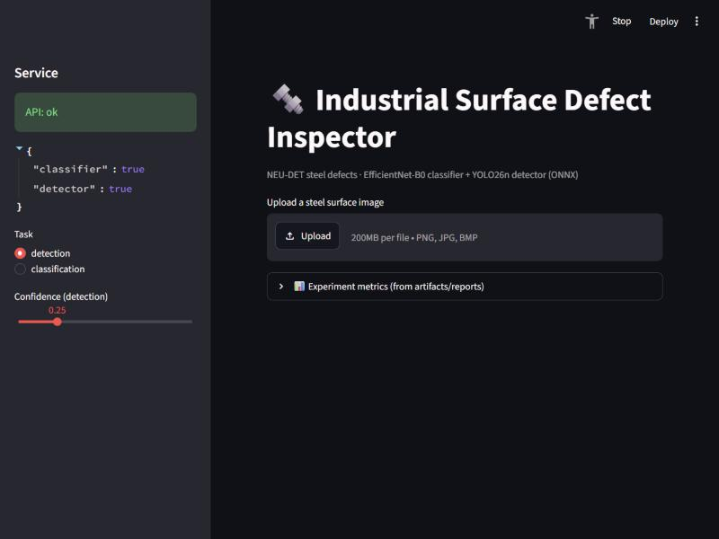

# Industrial Surface Defect Inspector

End-to-end, experiment-driven portfolio project for **steel surface defect inspection**:
image classification, object detection, segmentation/anomaly localization, ONNX
deployment, a FastAPI inference service, and a Streamlit demo.

> Status: **in progress** — see the milestone table below.

## Datasets

| Dataset | Role | Task | License | In repo? |
|---|---|---|---|---|
| [NEU-DET](https://www.kaggle.com/datasets/kaustubhdikshit/neu-surface-defect-database) | Primary | 6-class classification + bounding-box detection | Verify on original host | No (gitignored) |
| [MVTec AD](https://www.mvtec.com/research-teaching/datasets/mvtec-ad) | Secondary | Segmentation / anomaly localization | CC BY-NC-SA 4.0 (non-commercial) | No (gitignored) |

**NEU-DET**: 1,800 images, 200×200 grayscale steel textures, Pascal VOC XML boxes, six
balanced classes (300 each): `crazing, inclusion, patches, pitted_surface, rolled-in_scale, scratches`.

> **Important:** NEU-DET does *not* provide pixel segmentation masks. MVTec AD is a
> *separate* dataset used only for the segmentation/anomaly track. The two datasets are
> **not** a single unified benchmark and results are never ranked across them.

Raw images are kept out of Git. Only split manifests under `data/splits/` are committed.

## Six defect classes

| Class | Meaning |
|---|---|
| crazing | Network-like cracks |
| inclusion | Embedded impurity |
| patches | Surface patches |
| pitted_surface | Small localized pits |
| rolled-in_scale | Rolled oxide scale |
| scratches | Linear scratches |

## Repository layout

```
configs/        classification.yaml, detection.yaml, segmentation.yaml
data/           raw/ processed/ splits/ (only splits/*.csv committed)
notebooks/      01_eda.ipynb
src/inspection/ data, transforms, models, train/eval, inference, export
scripts/        audit_data.py, make_splits.py, voc_to_yolo.py, benchmark.py
api/            main.py (FastAPI)
ui/             streamlit_app.py
tests/          data/API/preprocess/onnx tests
artifacts/      reports/ figures/ checkpoints/ (large files ignored)
```

## Setup

```bash
python3.11 -m venv .venv
# Windows PowerShell:
.venv\Scripts\Activate.ps1
python -m pip install --upgrade pip
# Install the CUDA build of torch for your GPU first (see below), then:
python -m pip install -r requirements.txt
```

### PyTorch + CUDA (this machine: RTX 3050 6 GB laptop)

```bash
python -m pip install torch torchvision --index-url https://download.pytorch.org/whl/cu124
```

Verify: `python -c "import torch; print(torch.cuda.is_available(), torch.cuda.get_device_name(0))"`

## Reproduce

```bash
# Step 1 — audit + immutable splits
python scripts/repair_raw.py  --raw data/raw/neu_det
python scripts/audit_data.py  --raw data/raw/neu_det --out artifacts/reports
python scripts/make_splits.py --raw data/raw/neu_det --out data/splits --seed 42

# Step 2 — classification sweep (needs PYTHONPATH=src)
python scripts/run_cls_sweep.py --epochs 20

# Steps 4-5 — detection
python scripts/voc_to_yolo.py --raw data/raw/neu_det --splits data/splits --out data/processed/neu_det
python scripts/train_det.py   --config configs/detection.yaml   # --resume to continue

# Step 8 — ONNX export + parity + benchmark
python -m inspection.export_onnx --n 30
python scripts/benchmark.py --runs 100
```

### Run the demo (Steps 9-10)

```bash
# Terminal 1 — API (PYTHONPATH=src)
uvicorn api.main:app --host 127.0.0.1 --port 8000
# Terminal 2 — UI
streamlit run ui/streamlit_app.py
```

Then open http://localhost:8501. The UI calls the API's `/predict`; set
`INSPECTOR_API_URL` if the API is elsewhere.



## Hardware used

- GPU: NVIDIA GeForce RTX 3050 6 GB Laptop GPU
- CPU: Intel Core i7-13620H (10C/16T) · RAM: 16 GB · Windows 11

## Milestones

| Step | Status |
|---|---|
| 1. Data audit + immutable splits | ✅ done — see [DATA_REPORT](artifacts/reports/DATA_REPORT.md) |
| 2. Classification (CNN, ResNet, EfficientNet) | ✅ done — 10-run sweep, see [CLASSIFICATION_REPORT](artifacts/reports/CLASSIFICATION_REPORT.md) |
| 3. Feature maps / receptive field lab | ⬜ |
| 4. VOC→YOLO conversion | ✅ done (4,189 boxes, 0 rejected, same frozen split) |
| 5. YOLO26n detection | ✅ done — test mAP@0.5 0.782, see [DETECTION_REPORT](artifacts/reports/DETECTION_REPORT.md) |
| 6. MVTec segmentation / anomaly | ⬜ |
| 7. Evaluation + model selection | ⬜ |
| 8. ONNX export + parity | ✅ done — exact parity, 8× CPU speedup, see [ONNX_REPORT](artifacts/reports/ONNX_REPORT.md) |
| 9. FastAPI service | ✅ done — /health, /models, /predict (cls+det), 7 tests pass |
| 10. Streamlit demo | ✅ done — uploader, boxes, latency, metrics panel |

## License & attribution notes

- NEU-DET and MVTec AD images are **not** redistributed here; download them from the
  official sources and respect their licenses (MVTec AD is non-commercial).
- Ultralytics YOLO is AGPL-3.0 / Enterprise — review obligations before any commercial use.
