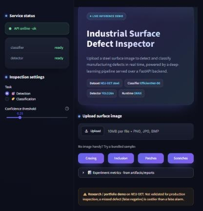
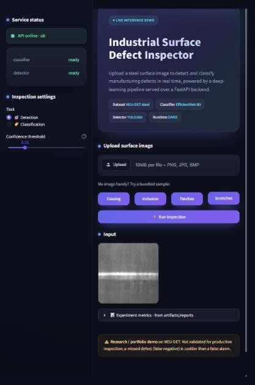
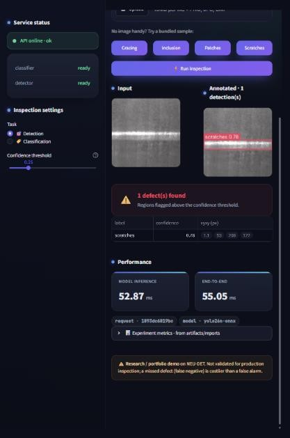
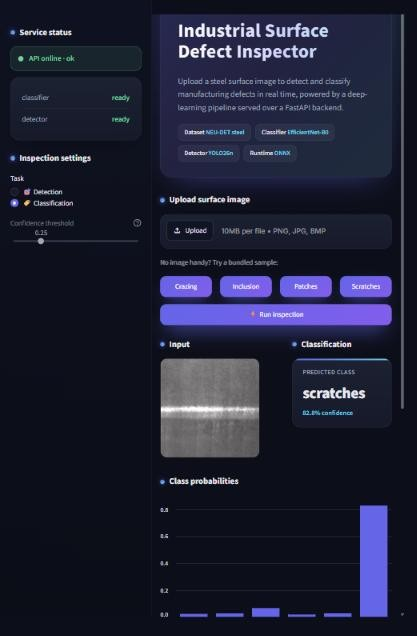
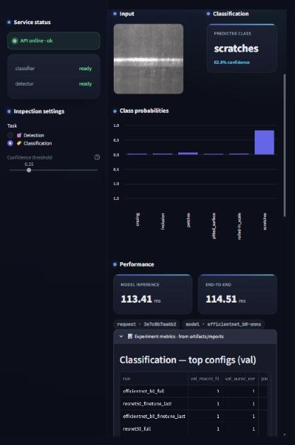

# How the demo works — step by step

A visual walkthrough of the Streamlit inspector UI (served by the FastAPI backend).

**Start both services** (from the repo root, with `PYTHONPATH=src`):

```bash
# Terminal 1 — API
uvicorn api.main:app --host 127.0.0.1 --port 8000
# Terminal 2 — UI
streamlit run ui/streamlit_app.py
```

Then open **http://localhost:8501**.

---

### 1. Open the app

The sidebar shows **service status** — the API health and whether the classifier and
detector models are loaded (`ready`). Under **Inspection settings** you pick the task
(Detection or Classification) and, for detection, a confidence threshold. The main panel
has the hero, an upload dropzone, and quick **sample buttons**.



### 2. Load an image

Drag-and-drop a steel surface image, or click a bundled **sample** (Crazing, Inclusion,
Patches, Scratches). The chosen image appears under **Input**, and a **Run inspection**
button appears.



### 3. Run detection

With the task set to **Detection**, click **Run inspection**. The annotated image shows
colour-coded bounding boxes with per-box confidence, a **verdict banner** (defect found /
clean), a table of detections in pixel-space `xyxy`, and **latency** tiles
(model inference vs end-to-end) plus the request ID and model name.



### 4. Run classification

Switch the task to **Classification** and run again. The UI shows the **predicted class**
with its confidence and a **class-probability** bar chart across all six defect types.



### 5. Inspect the experiment metrics

Expand **Experiment metrics** at the bottom to see the committed results read straight from
`artifacts/reports/` — top classification configs, YOLO test mAP, and ONNX latency.



---

> The **sample buttons** load bundled NEU-DET test images from `ui/samples/` so the demo
> can be tried without your own image; uploading a file always takes precedence over a
> selected sample. All inference goes through the FastAPI `/predict` endpoint — the UI holds
> no model state of its own.
